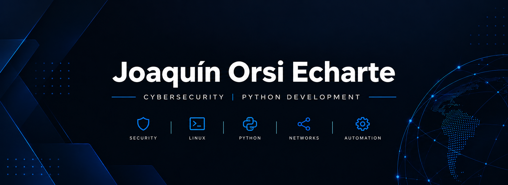

<h1 align="center">Joaquín Orsi Echarte</h1>
<h3 align="center">Cybersecurity | Security Labs | Python & Security Automation</h3>

  

## About Me

I'm building my career in **cybersecurity**, combining hands-on security labs, network and web security analysis, Linux, and Python-based tooling. My background also includes administrative work and software development, which I bring to technical problem-solving and documentation.

I explore both **defensive and offensive security fundamentals** in controlled, authorized environments: understanding how systems work, examining potential vulnerabilities, analyzing network traffic, and documenting findings and mitigations.

I'm interested in **junior cybersecurity opportunities** and **freelance projects** aligned with my practical skills, including technical documentation, Python automation, application testing, and security-related tooling.

---

## Cybersecurity Focus

- **Network security:** TCP/IP fundamentals, traffic inspection, service discovery, and port scanning
- **Web security:** HTTP/HTTPS, intercepting proxies, request analysis, and web testing fundamentals
- **Defensive security:** log analysis, security hardening, risk assessment, and reporting
- **Offensive security fundamentals:** reconnaissance and vulnerability assessment in authorized labs
- **Systems and automation:** Linux, virtualized environments, and Python security tools

### Tools & Environments

Additional lab tools: `Gobuster` · `WhatWeb` · `curl` · `YARA` · `binwalk` · `foremost` · `ExifTool`.

---

## Featured Security Work

### [Cybersecurity Labs](https://github.com/JORSIECHARTE/cybersecurity-labs)

A collection of practical cybersecurity exercises conducted in controlled and authorized environments, focused on repeatable procedures and technical documentation.

**Topics:** Network security · Web security · Traffic analysis · Vulnerability assessment · Defensive analysis · Hardening

**Featured lab — [Burp Suite Proxy Lab](https://github.com/JORSIECHARTE/cybersecurity-labs/tree/main/burp-suite-proxy-lab)**

A two-virtual-machine setup for studying HTTP/HTTPS interception and proxy behavior, including virtual networking, CA certificate configuration, HTTP history, request modification, and defensive implications.

### [Aegis Security Toolkit](https://github.com/JORSIECHARTE/Aegis-Security-Toolkit)

A Python-based educational security toolkit focused on defensive assessment and reporting.

**Features:** Network discovery · TCP port scanning · Service detection · Password analysis · Log analysis · Risk assessment · Security reports

**Stack:** Python · Streamlit · SQLite · Networking

---

## Software Development

I also build software and automation tools. Development supports my cybersecurity work by helping me understand applications, APIs, data handling, and the systems I assess.

**Languages:** Python · SQL · JavaScript · HTML · CSS

**Databases:** PostgreSQL · MongoDB · SQLite

**Development tools:** Git · GitHub · VS Code · Docker

### [IA-Recetas](https://github.com/JORSIECHARTE/IA-Recetas)

A software project focused on recipe management, information processing, and automation. It represents part of my broader application-development experience.

---

## Continuous Learning

My ongoing studies and practical work cover:

- Cybersecurity and ethical hacking fundamentals
- Network and web security
- Linux systems and security
- Security operations and defensive analysis
- Cryptography, PKI, and identity and access management
- CompTIA Security+ exam topics

My approach combines **technical study, hands-on labs, and building tools**. Lab projects and software repositories provide examples of that work.

---

## Contact

<strong>Cybersecurity · Security Labs · Python · Linux · Network Security</strong>

